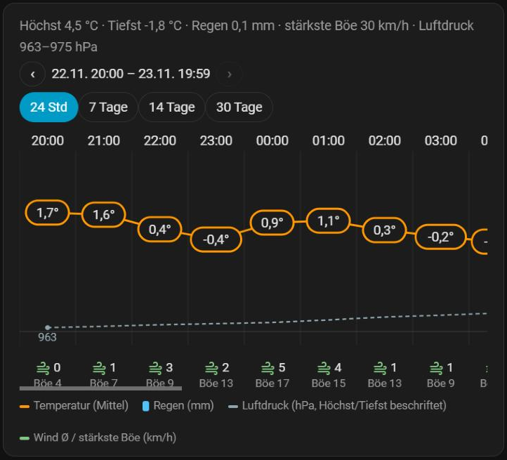

# Wetter-Verlauf-Karte

Gemessene Wetterwerte (Temperatur, Regen, Wind, Luftdruck) mit Zeitraumwahl und Blättern



## Installation

### Über den Marketplace (Home Assistant 2026.11 und neuer)

1. **Einstellungen** → **Marketplace** → **Aus Link hinzufügen**.
2. Die Adresse dieses Repositorys eintragen, Kategorie **Dashboard**.
3. **Wetter-Verlauf-Karte** installieren. Die Ressource wird dabei automatisch eingetragen.

### Über HACS (ältere Versionen)

**HACS** → ⋮ → **Benutzerdefinierte Repositories** → Adresse dieses Repositorys, Typ **Dashboard** → installieren.

### Manuell

`wetter-verlauf-karte.js` nach `/config/www/` kopieren und unter **Einstellungen** → **Dashboards** → ⋮ → **Ressourcen**
als JavaScript-Modul `/local/wetter-verlauf-karte.js` eintragen.

## Verwendung

```yaml
type: custom:wetter-verlauf-karte
```

## Konfiguration

```
Wetter-Verlauf-Karte: gemessene Werte der eigenen Wetterstation aus der Langzeitstatistik,
gleiche Optik wie die Wetter-Karte, mit Zeitraumwahl und Blaettern.
Tage: Hoechst-/Tiefstwert, Regen, Wind (Mittel + staerkste Boee); Stunden: Mittelwert, Regen, Wind.

  type: custom:wetter-verlauf-karte
  temperatur: sensor.wetterstation_outdoor_temperature
  regen: sensor.wetterstation_total_rain        # Zaehler (Summe), pro Tag/Stunde wird die Aenderung genommen
  wind: sensor.wetterstation_wind_speed
  boee: sensor.wetterstation_wind_gust
  luftdruck: sensor.wetterstation_relative_pressure   # optional, als Kurve im unteren Bereich
```

## Lizenz

MIT
